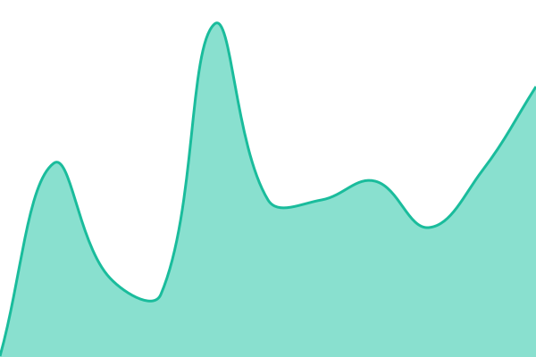
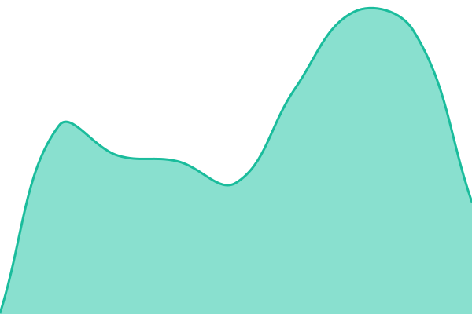

# [📈 Live Status](https://RiverGamesStudios.github.io/uptime): <!--live status--> **🟧 Partial outage**

This repository contains the open-source uptime monitor and status page for [River Games](https://rivergames.ca), powered by [Upptime](https://github.com/upptime/upptime).

With [Upptime](https://upptime.js.org), you can get your own unlimited and free uptime monitor and status page, powered entirely by a GitHub repository. We use [Issues](https://github.com/RiverGamesStudios/uptime/issues) as incident reports, [Actions](https://github.com/RiverGamesStudios/uptime/actions) as uptime monitors, and [Pages](https://RiverGamesStudios.github.io/uptime) for the status page.

<!--start: status pages-->
<!-- This summary is generated by Upptime (https://github.com/upptime/upptime) -->
<!-- Do not edit this manually, your changes will be overwritten -->
<!-- prettier-ignore -->
| URL | Status | History | Response Time | Uptime |
| --- | ------ | ------- | ------------- | ------ |
|  [River Games](https://rivergames.ca) | 🟥 Down | [river-games.yml](https://github.com/RiversoftStudios/uptime/commits/HEAD/history/river-games.yml) | 

 0ms
     
 | 

<a href="https://RiversoftStudios.github.io/uptime/history/river-games">0.00%</a>
    

|  [Riverpedia](https://wiki.rivergames.ca) | 🟥 Down | [riverpedia.yml](https://github.com/RiversoftStudios/uptime/commits/HEAD/history/riverpedia.yml) | 

 0ms
     
 | 

<a href="https://RiversoftStudios.github.io/uptime/history/riverpedia">0.00%</a>
    

|  [River Blogs](https://blog.rivergames.ca) | 🟥 Down | [river-blogs.yml](https://github.com/RiversoftStudios/uptime/commits/HEAD/history/river-blogs.yml) | 

 0ms
     
 | 

<a href="https://RiversoftStudios.github.io/uptime/history/river-blogs">0.00%</a>
    

|  [PMC Studios](https://pmcstudios.uk) | 🟩 Up | [pmc-studios.yml](https://github.com/RiversoftStudios/uptime/commits/HEAD/history/pmc-studios.yml) | 

 186ms
     
 | 

<a href="https://RiversoftStudios.github.io/uptime/history/pmc-studios">100.00%</a>
    

|  [Little Blue Guy](https://littlebluedev.ca) | 🟩 Up | [little-blue-guy.yml](https://github.com/RiversoftStudios/uptime/commits/HEAD/history/little-blue-guy.yml) | 

 227ms
     
 | 

<a href="https://RiversoftStudios.github.io/uptime/history/little-blue-guy">100.00%</a>
    

|  [colebohte Apache2](https://foxington.cloud-ip.cc) | 🟥 Down | [colebohte-apache2.yml](https://github.com/RiversoftStudios/uptime/commits/HEAD/history/colebohte-apache2.yml) | 

 0ms
     
 | 

<a href="https://RiversoftStudios.github.io/uptime/history/colebohte-apache2">0.01%</a>
    

<!--end: status pages-->

[**Visit our status website →**](https://RiverGamesStudios.github.io/uptime)

## 📄 License

- Powered by: [Upptime](https://github.com/upptime/upptime)
- Code: [MIT](./LICENSE) © [Anand Chowdhary](https://anandchowdhary.com), supported by [Pabio](https://pabio.com)
- Data in the `./history` directory: [Open Database License](https://opendatacommons.org/licenses/odbl/1-0/)
